# Creer

**A warm, fast digital audio workstation for the web.** Make a beat, hum a melody, borrow a loop and turn it into a song — all in the browser, with no account and no upload.

**Play online:** [**ahpah-dev.github.io/creer**](https://ahpah-dev.github.io/creer/)

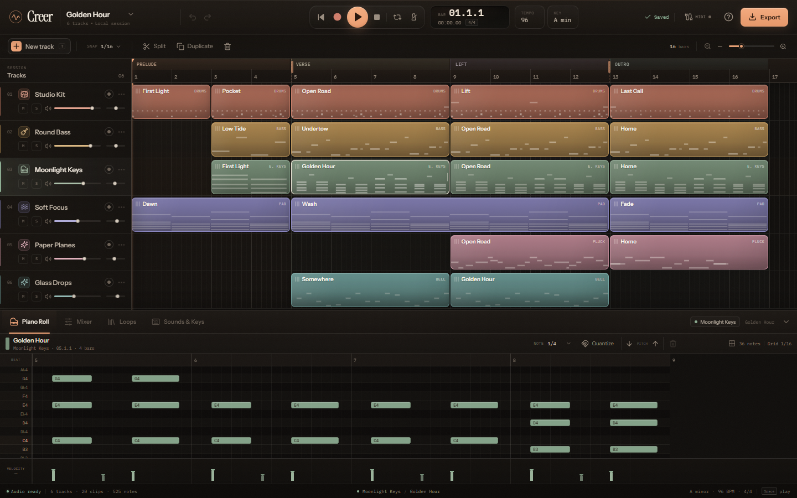

## Open it

### Play online

Open **[ahpah-dev.github.io/creer](https://ahpah-dev.github.io/creer/)**. The site is served over HTTPS, so Web MIDI permissions are available directly in the browser.

### The quick way

[**Download Creer.html**](https://github.com/ahpah-dev/creer/releases/latest/download/Creer.html) from the latest release and double-click it. It is a self-contained build of the whole studio: all of the code, fonts and artwork are inside one file. No install, no server.

> Your projects are stored in the browser's local storage for that file. Use **Project menu → Save a copy** to keep a `.creer.json` backup.

### Start the development studio

Double-click **`Start Creer.bat`**, or run:

```bash
npm install
npm run dev
```

Then open the local address that Vite prints.

To produce the packed file again:

```bash
npm run build:standalone
```

That writes `standalone/index.html`, the finished `Creer.html`, and the GitHub Pages copy at `docs/index.html`.

## What is inside

- **Six-track demo song, “Golden Hour”** — play it immediately, solo parts, or pull it apart to learn how it was built.
- **Piano-roll editor** — draw, drag, resize and nudge notes, change velocity, quantize, transpose, split clips, and edit drum patterns by drum name. Drag a note up or down and you hear each new pitch as it moves; drag any selected note and the whole selection moves together. Zoom in from 100% to 800% with the − / + controls, or hold Ctrl/⌘ and scroll to zoom around the pointer. Drag the grip above the editor tabs to make the piano roll as tall as you like; double-click the grip to reset its height.
- **Spark an idea** — press **Idea** to generate a whole section in one click. Six styles write drums, bass, chords, texture and a melody into matching tracks, add a named section, and can start playing immediately. Undo is one step.
- **Instrument library** — 54 synthesized sounds across Keys, Bass, Pads, Leads and Drums, including nine drum kits. Filter by **New** to find the 2.0 additions. Search or filter the collection, audition any sound, load it onto the current track with one click, or grow a new track from it.
- **New in the 2.0 sound update** — Concert Grand (stretched, inharmonic partials with twin-string beating, hammer felt and damper release), Funk Clav, Steel Pan, Cathedral Organ, Acid Line, Upright Bass, Rubber Pulse, Velour Poly, Crystal Pad, Tape Strings, Steel Strings, Harmon Trumpet, Clay Ocarina and Chip Lead, plus Trap, House and Dusty Breaks kits with metallic six-oscillator cymbals.
- **Voice controls** — every track now has Octave, Attack, Tone and Dynamics controls in **Sounds & Keys**. They shape live playing, playback and WAV export, and are saved with the project.
- **Natural releases** — live notes now ring out with each instrument's own release instead of cutting off, and the shared reverb uses a new room impulse with early reflections and a tail that darkens as it fades.
- **The sounds** — from Velvet Piano, Silver Celesta, Vibraphone and Harpsichord to Eight Oh Eight, Reese, Nylon Guitar, Air Flute, Brass Room, Super Saw and Solo Cello. The drum room now holds Studio, Lo-Fi, Hand Percussion, Vintage, 808 and Brush kits. Every one is built from oscillators, filters, FM and noise.
- **Live MIDI-style recording** — arm a track, hit record and play the keys or pads. Captured takes land in the arrangement.
- **MIDI keyboard input** — connect a hardware keyboard through the MIDI button in the top bar. Note on/off, velocity, sustain and hot-plugging are supported, and incoming MIDI is captured while recording.
- **Box selection & clipboard** — drag a box over empty timeline space to select clips, or switch the piano roll to **Select** and drag a box over notes. Cut, copy and paste either selection from the toolbar or with `Ctrl/⌘ + X / C / V`. Dragging one selected note moves every selected note together.
- **Effect chains** — open the **Effects** tab to build an eight-slot insert chain on any track or the master. Filter, drive, EQ, chorus, phaser, tremolo, auto-pan, delay, room reverb, compressor and bitcrush are available; each can be bypassed, reordered and adjusted live, and the same chain is used in WAV exports.
- **Loop library** — ten curated, tempo-aware parts that preview and drop into the song.
- **Swing mode** — open the **SWING** pill in the top bar to enable 8th- or 16th-note swing, then dial it from straight to a full triplet feel. It is applied to playback and WAV exports.
- **Mixer** — per-track faders, pans, reverb/delay sends, mute/solo and meters, plus a master strip with its own effects and limiter.
- **Arrangement tools** — drag clips across tracks, resize them, loop sections, scrub the timeline, zoom, snap, duplicate, split and undo. Song sections are yours: rename and recolor them from the pencil, add new ones with **+**, or delete them.
- **WAV export** — offline-rendered stereo 44.1 kHz / 16-bit master, with all effects and the reverb tail.
- **Local-first workflow** — autosaves to the browser, exports/imports project files, and makes a copy with one click.

The audio is synthesised live with Web Audio. There are no samples or external audio assets.

> **New in 2.0** — fourteen new instruments and three new drum kits, per-track Voice controls, natural key releases, a richer reverb, and a studio redesign: tinted clips with coloured header strips, alternating bar shading, pill-style dock tabs, arc knobs, a larger and more legible type scale and a refreshed instrument library.
>
> **New in 1.8** — **Spark an idea** builds a complete section in one click: six styles, drums, bass, chords, texture and melody, with optional instant playback and a timeline that follows the new section. The 1.7.1 release added group note dragging; 1.7 added fourteen new sounds: Silver Celesta, Vibraphone, Harpsichord, Eight Oh Eight, Reese, Nylon Guitar, Air Flute, Brass Room, Super Saw, Solo Cello, Halo Pad, plus Vintage, 808 and Brush drum kits. The 1.6 release added per-track and master insert effect chains, 1.5 added box selection and clipboard editing, 1.4 added swing mode, 1.3 added vertical piano-roll resizing, 1.2 added piano-roll zoom, and 1.1 brought the original 22-sound instrument library, live pitch feedback while dragging notes, and editable song sections.

## A look inside

### Piano-roll zoom
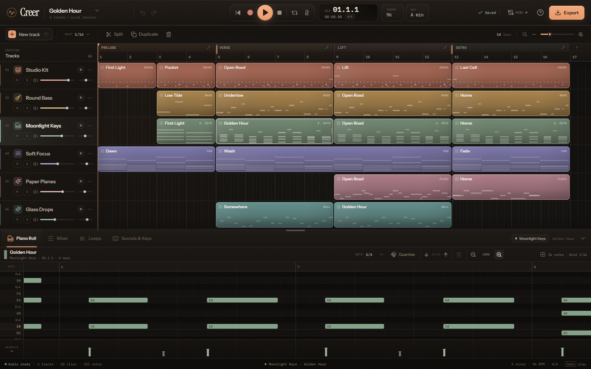

### Resizable piano roll
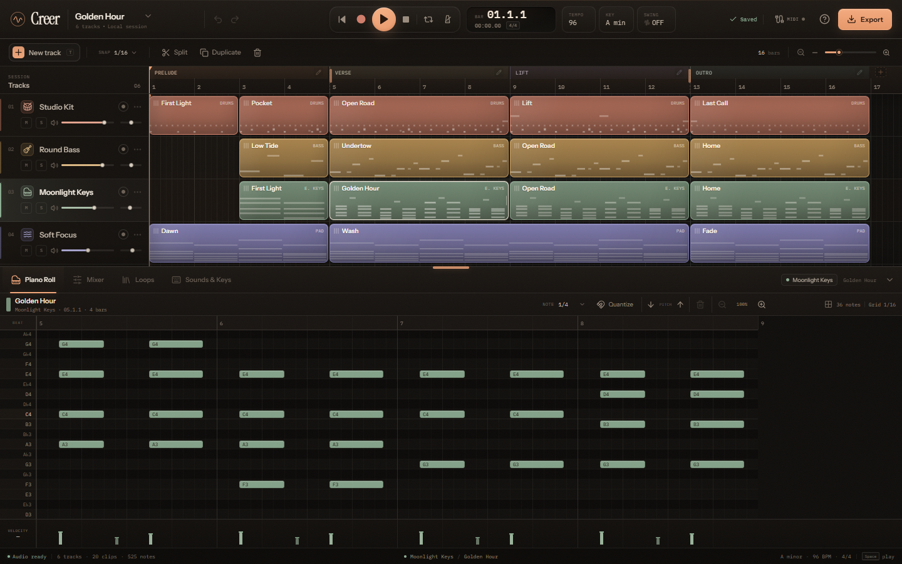

### Box selection & clipboard
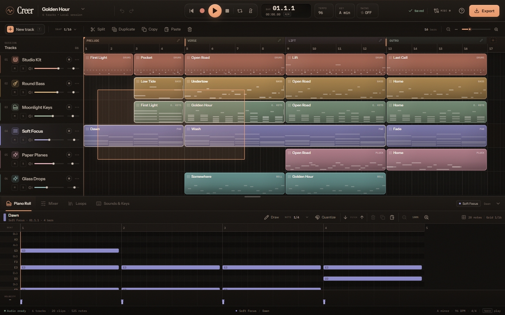

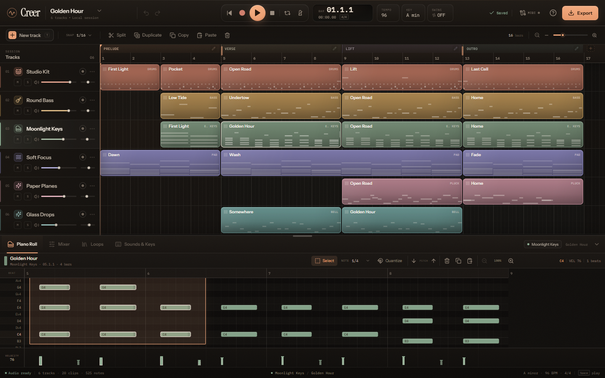

### Instrument library
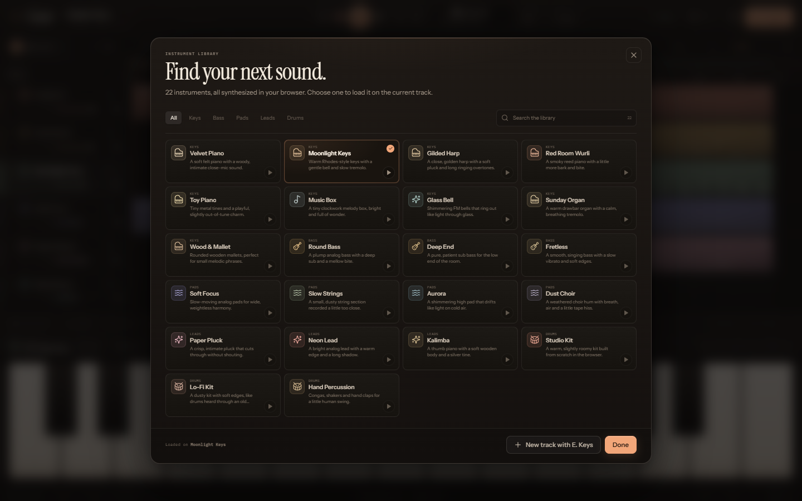

### Drum kits
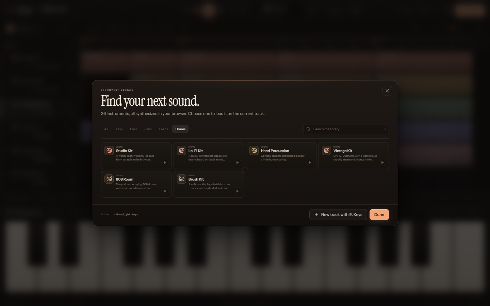

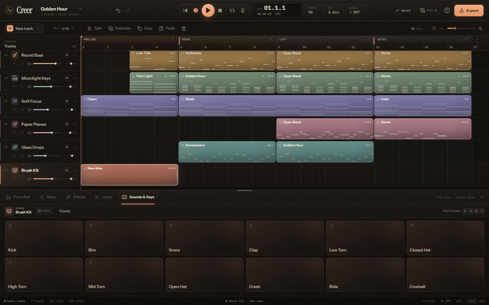

### Spark an idea
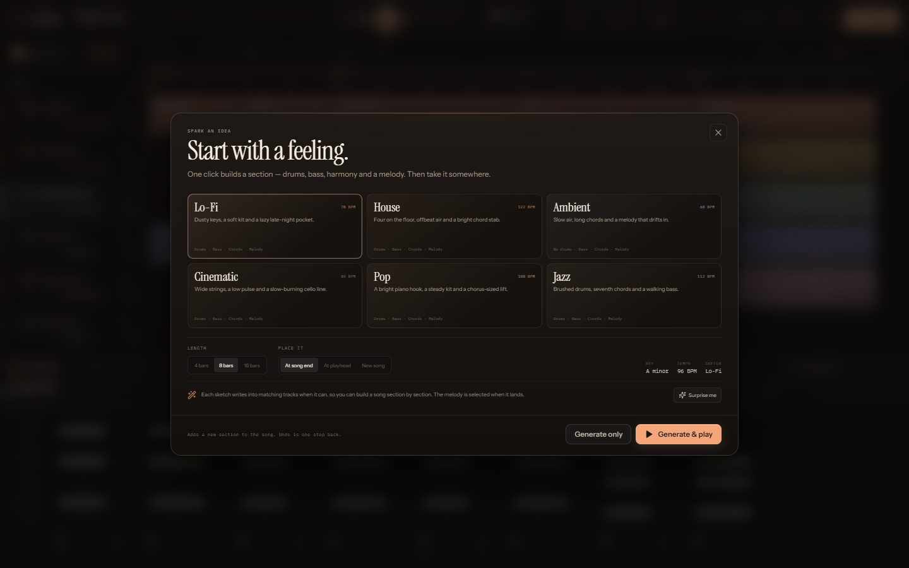

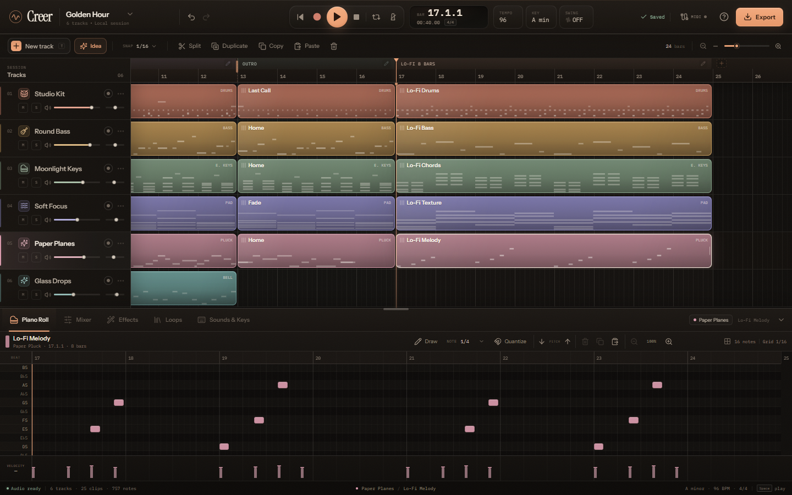

### Song sections
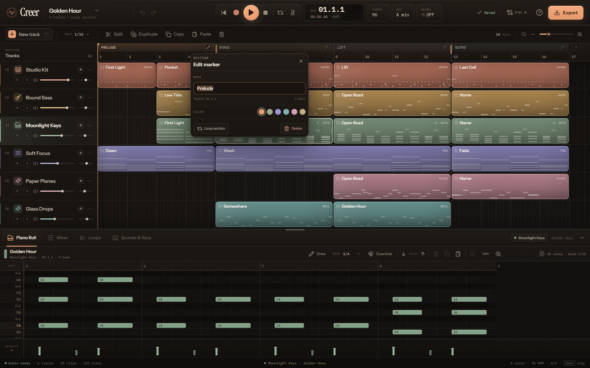

### Mixer
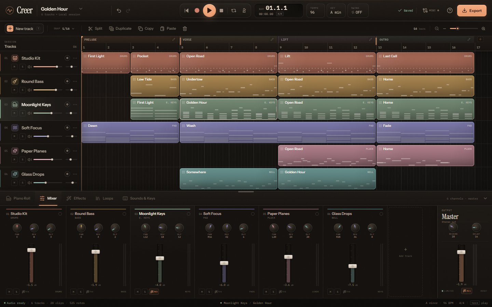

### Loop library
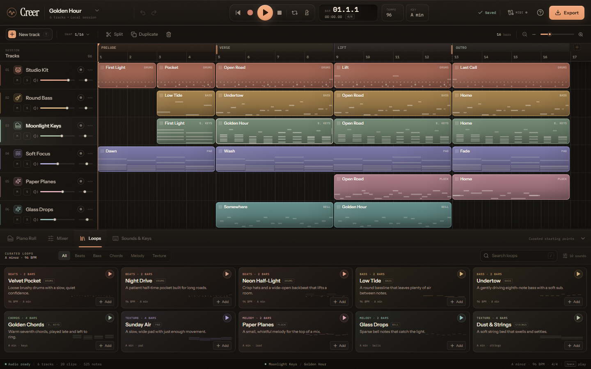

### Effects
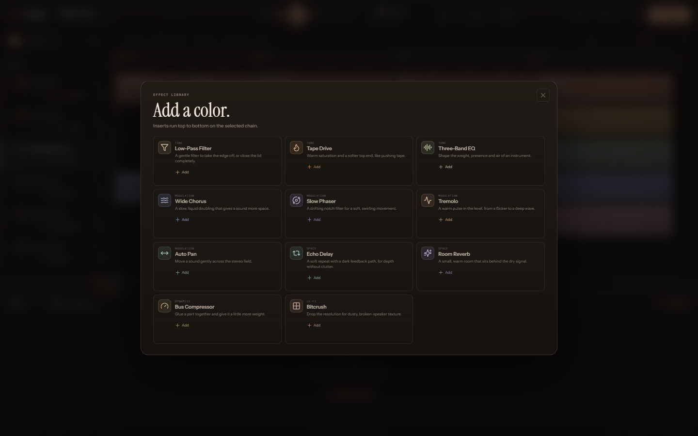

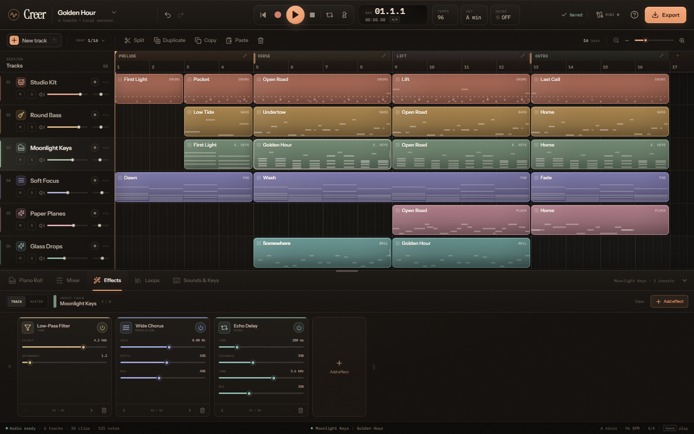

### Swing
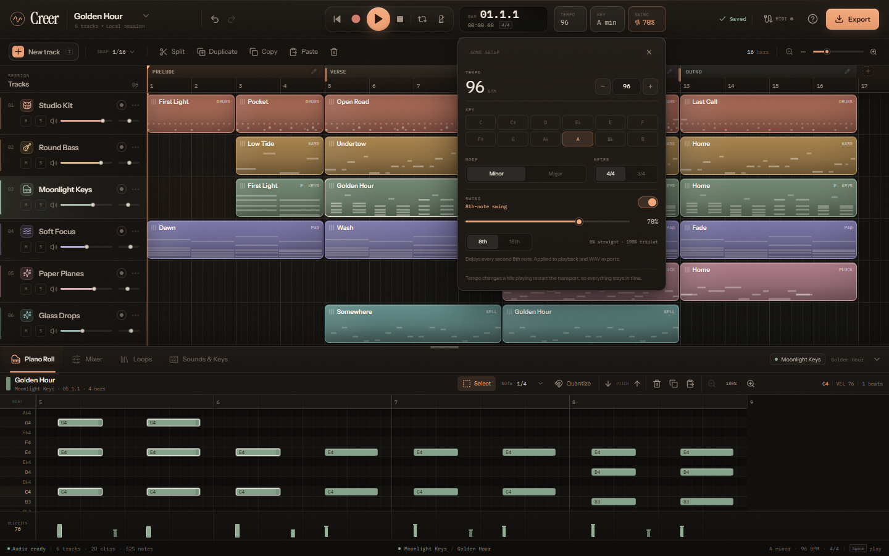

### Sounds & Keys
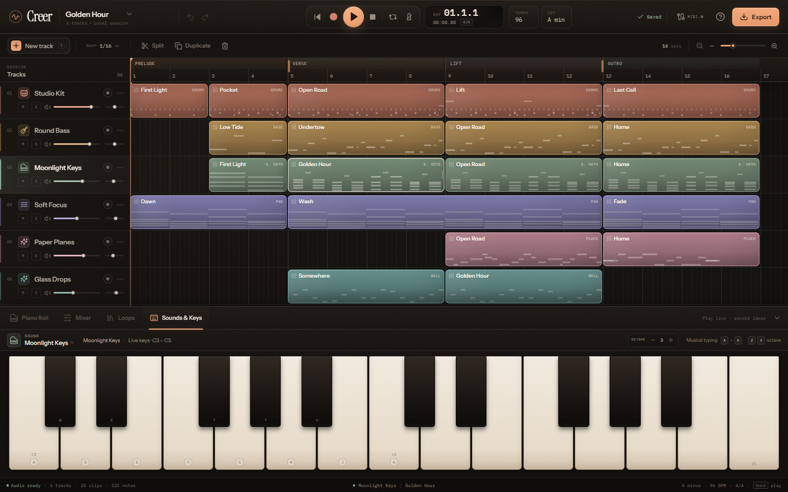

## A short tour

| Area | What to do |
| --- | --- |
| Transport | `Space` plays and pauses. `L` toggles the loop. `R` starts/stops a take. |
| Arrangement | Double-click an empty lane for a new clip. Drag across empty space to box-select clips; Shift adds to the selection. Double-click a clip to open its editor. Hover a section and use the pencil to rename, recolor, loop or delete it; **+** adds a section. |
| Piano roll | Click to draw, drag to move, use the right handle to resize. Use the **Draw / Select** button (or Shift + drag) for box selection. Drag any selected note to move the whole selection. Moving a note up or down auditions the new pitch. Zoom with the − / + control or Ctrl/⌘ + scroll; click the percentage to fit. Drag the grip above the editor tabs to resize vertically; double-click it to reset. The lower lane edits velocity. |
| Clipboard | `Ctrl/⌘ + X`, `C`, `V` cut, copy and paste notes in the piano roll or clips in the timeline. Copy/paste is also available from the timeline toolbar and the piano-roll copy/paste buttons. |
| Spark an idea | Press **Idea** in the toolbar. Choose a style, length and placement, then **Generate & play** or **Generate only**. The new section can reuse matching tracks or start a fresh sketch. |
| Instrument library | Open **Sounds & Keys** and click the sound name (or **Browse**). Search, audition, then click a card to load it on the current track. |
| Recording | Arm a track with the dot in its header, press record, then play the on-screen keys or pads. |
| Loops | Open the **Loops** tab, preview with the play button, add with **Add**. |
| Effects | Open **Effects**, choose **Track** or **Master**, and click **Add effect**. Adjust the card controls, reorder with the arrows, and bypass with the power button. Each chain holds up to eight inserts. |
| Swing | Open the **SWING** pill in the top bar, switch it on, choose 8th or 16th notes and set the amount. The same timing is used in the WAV export. |
| Mixer | Faders, pan, reverb/delay sends and master effects. Double-click a knob to reset it to its natural centre. |
| MIDI | Click **MIDI** in the top bar, enable input and choose your keyboard. It plays the armed track (or the selected track if none is armed). |
| Export | **Export** renders the full arrangement to a WAV. Loop settings are not applied to the bounce. |

## Keyboard shortcuts

| Shortcut | Action |
| --- | --- |
| `Space` | Play / pause |
| `Ctrl/⌘ + Z` | Undo |
| `Ctrl/⌘ + Shift + Z` | Redo |
| `Ctrl/⌘ + D` | Duplicate selected clip |
| `Ctrl/⌘ + C` / `X` / `V` | Copy / cut / paste notes or clips |
| `Ctrl/⌘ + A` | Select all notes in the open clip, or all clips in the timeline |
| `Shift + drag` | Add a box selection in the timeline or piano roll |
| `Delete / Backspace` | Delete selected notes, or the selected clip |
| `R` | Record a take |
| `L` | Toggle loop |
| `M` / `S` | Mute / solo the selected track |
| `T` | New track |
| `1` – `5` | Switch editors |
| `Arrow keys` | Seek by bar; nudge selected notes |
| `A` – `K` | Musical typing (when Sounds & Keys is open) |
| `Z` / `X` | Octave down / up (keyboard) |
| `Alt + drag` | Move without snapping |
| `?` | Open help |

## Under the hood

- **React 19 + TypeScript + Vite.**
- A custom Web Audio engine with a lookahead beat scheduler, per-track bus, pans, sends, convolution reverb and tempo-synced delay.
- Synthesis voices built from oscillators, filters, FM and noise — no sample files.
- OfflineAudioContext bounce → 16-bit PCM WAV encoder.
- Zustand state with an undo history, coalesced slider gestures, and debounced localStorage persistence.
- A single-file build that inlines the compiled app, fonts and favicon.

## MIDI keyboards

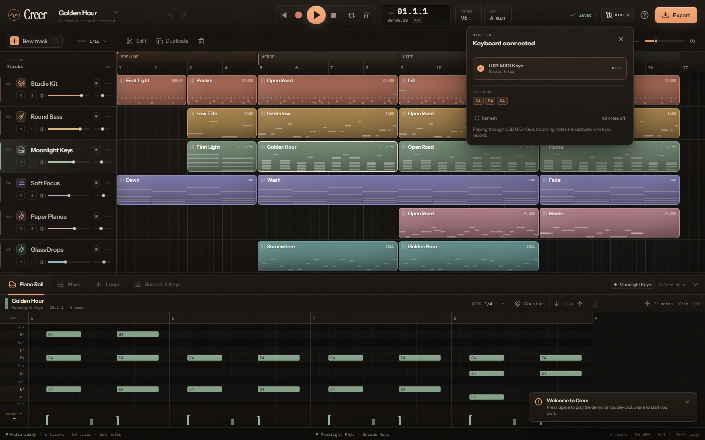

1. Click the **MIDI** button in the top bar.
2. Choose **Enable MIDI input** and allow MIDI access when your browser asks.
3. Select your keyboard from the list. The green dot means it is live.

Incoming notes play through the **armed** track, falling back to the selected track. If you are recording, the notes and velocities are written into the take. Sustain (CC64), hot-plugging and “all notes off” are handled. If you are using the standalone file and the browser blocks MIDI permissions, run `Start Creer.bat` and use the localhost version instead — MIDI permissions are most reliable there.

## Notes & scope

- Creer is built and tested in a current Chrome/Chromium browser, which is recommended. It uses modern Web Audio, Web MIDI and CSS features. Audio starts after your first click (a browser requirement).
- This is a **synthesis-first** studio: it records MIDI-style performances from hardware and on-screen instruments rather than microphone audio.
- A full-song export renders offline and can take 20–40 seconds depending on the song and machine. The export dialog keeps you posted.
- Everything is generated locally. Nothing is uploaded anywhere.

## License

**Unlicense** — this is free and unencumbered software released into the public domain. See [LICENSE](LICENSE).

Source: [github.com/ahpah-dev/creer](https://github.com/ahpah-dev/creer)

Made for making something.
